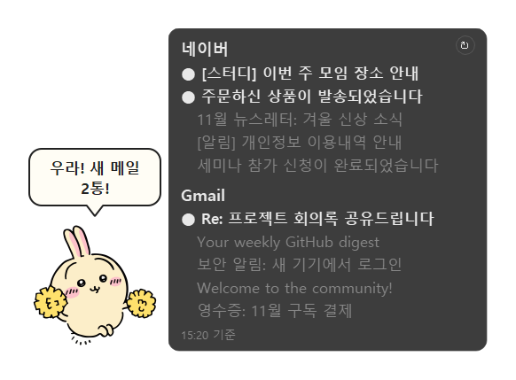

# usagi-mail

네이버 메일과 Gmail의 최근 메일 제목을 바탕화면 위젯으로 보여주고, 제목을 누르면 브라우저에서 해당 메일을 바로 여는 Windows 데스크톱 앱입니다.
옆에서 우사기가 말풍선으로 새 메일·안 읽은 메일 상태를 알려줍니다.



<sub>※ 스크린샷의 메일 목록은 예시 데이터입니다.</sub>

## 주요 기능

- **메일 목록**: 네이버·Gmail 받은편지함의 최근 메일 10개(설정 가능) 제목 표시, 안 읽은 메일은 `●` + 굵게
- **바로 열기**: 제목 클릭 시 브라우저에서 해당 메일이 바로 열림 (네이버 `mail.naver.com/v2/read/0/<UID>`, Gmail `X-GM-MSGID` 기반 링크)
- **우사기 말풍선**: 상태에 따라 이미지와 대사가 바뀜
  | 상태 | 조건 | 대사 예시 |
  |---|---|---|
  | 새 메일 | 직전 새로고침 이후 도착한 메일 (UID 비교) — 메일이나 우사기를 클릭할 때까지 유지 | 우라! 새 메일 N통! |
  | 안 읽은 메일 | 목록에 안 읽은 메일이 있음 | 훙? 안 읽은 메일 N통 |
  | 평소 | 안 읽은 메일 없음 | 푸루루루… |
  | 연결 실패 | 네트워크·로그인 오류 | 하아?! 연결이 안 돼 |
- **데스크톱 위젯**: 다른 창 아래에 고정, 드래그로 이동, 모니터 구성(듀얼/단일)별 위치 자동 저장·복원
- **자동 새로고침**: 기본 3분 주기 + ↻ 버튼, 우클릭/트레이 메뉴(숨기기·새로고침·종료)

## 동작 방식

```
main.py (PyQt5 위젯) ──백그라운드 스레드──> mail.py ──IMAP over SSL(993)──> imap.naver.com / imap.gmail.com
        │                                     │
        └ config.json (주소·주기·창 위치)      └ Windows 자격 증명 관리자 (앱 비밀번호, keyring)
```

- 네이버는 OAuth(네이버 로그인)로 메일 읽기 권한을 제공하지 않아, 두 서비스 모두 **IMAP + 앱 비밀번호**를 사용합니다.
- 받은편지함을 **읽기 전용(EXAMINE)** 으로 열고 헤더만 `BODY.PEEK`로 가져오므로, 메일이 읽음 처리되지 않고 본문도 받지 않습니다.

## 요구 사항

- Windows 10/11
- Python 3.10+ (개발: 3.13)
- 네이버·Google 계정의 2단계 인증 + 앱 비밀번호

## 설치

1. **앱 비밀번호 발급**
   - 네이버: 메일 → 환경설정 → POP3/IMAP 설정 → **IMAP/SMTP 사용함**, 내정보 → 보안설정 → 2단계 인증 → **애플리케이션 비밀번호** 생성
   - Google: 2단계 인증 사용 후 https://myaccount.google.com/apppasswords 에서 생성
2. **설치**
   ```powershell
   git clone https://github.com/<user>/usagi-mail.git
   cd usagi-mail
   python -m venv .venv
   .venv\Scripts\pip install -r requirements.txt
   copy config.example.json config.json   # 메일 주소 수정
   ```
3. **앱 비밀번호 저장** (입력값은 화면에 표시되지 않음)
   ```powershell
   .venv\Scripts\python setup_cred.py
   ```

## 실행 · 빌드

```powershell
.venv\Scripts\python main.py          # 개발 실행
.venv\Scripts\python test_mail.py     # 테스트
.venv\Scripts\pip install pyinstaller
powershell -ExecutionPolicy Bypass -File build.ps1   # -> dist\usagi-mail\usagi-mail.exe
```

- `dist`의 `config.json`은 최초 1회만 복사되어, 재빌드해도 저장된 창 위치가 유지됩니다.
- 자동 실행: `%APPDATA%\Microsoft\Windows\Start Menu\Programs\Startup`에 15초 대기 후 exe를 실행하는 `.vbs`를 두면 됩니다.

## 설정 (`config.json`)

| 키 | 설명 | 기본값 |
|---|---|---|
| `accounts.naver` / `accounts.gmail` | 메일 주소 | - |
| `refresh_seconds` | 자동 새로고침 주기(초) | 180 |
| `max_items` | 계정별 표시 개수 | 10 |
| `positions` | 모니터 구성별 창 위치 (자동 저장) | - |

## 캐릭터 이미지

이미지는 저장소에 **포함되어 있지 않습니다.** `assets/private/`에 PNG를 넣으면 파일명 접두어로 상태를 구분해 랜덤으로 사용합니다.

| 접두어 | 상태 |
|---|---|
| `new_` | 새 메일 |
| `unread_` | 안 읽은 메일 (없으면 `idle_` 사용) |
| `idle_` | 평소 |
| `error_` | 연결 실패 (없으면 `idle_` 사용) |

흰 배경은 실행 시 테두리 바깥만 자동으로 투명 처리됩니다. 이미지가 하나도 없어도 말풍선과 목록은 정상 동작합니다.
대사는 `main.py`의 `PHRASES`에서 바꿀 수 있습니다.

## 보안 설계

- 앱 비밀번호는 파일이 아닌 **Windows 자격 증명 관리자**(keyring)에만 저장하며, 계정 비밀번호 대신 언제든 폐기 가능한 앱 비밀번호만 사용합니다.
- `config.json`, 토큰·OAuth 클라이언트 파일, 캐릭터 이미지, 빌드 결과물은 `.gitignore`로 제외합니다.
- IMAP은 SSL + 인증서 검증(`ssl.create_default_context`)으로 접속하고, 오류 메시지에 비밀번호를 포함하지 않습니다.
- 메일 제목·발신자는 외부 입력이므로 `Qt.PlainText`로만 표시하고(HTML 해석 안 함), 브라우저로 여는 URL은 `mail.naver.com`·`mail.google.com`으로 제한합니다.

## 프로젝트 구조

```
main.py             위젯 UI, 우사기·말풍선, 트레이, 모니터별 위치
mail.py             IMAP 조회, 메일 링크 생성, 설정 입출력
setup_cred.py       앱 비밀번호를 keyring에 저장
test_mail.py        파싱·상태 판정·이미지 선택 테스트
build.ps1           PyInstaller onedir 빌드
config.example.json 설정 예시
```

## 저작권

「치이카와(ちいかわ)」와 우사기 캐릭터의 저작권은 나가노(ナガノ) 및 권리자에게 있습니다.
이 저장소는 개인 학습·사용 목적의 비공식 팬 프로젝트입니다. 앱 실행에 필요한 캐릭터 이미지는 포함하지 않으며, 스크린샷은 동작 예시용입니다.
